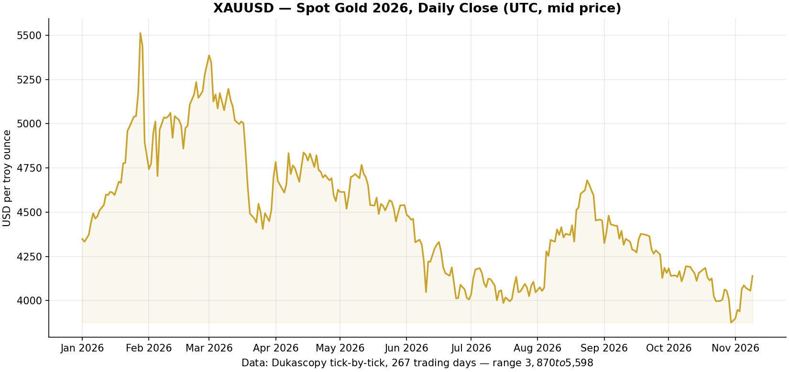

# XAUUSD Tick Data 2026 — Free Gold Tick-by-Tick Historical Dataset (CSV)

**Complete tick-by-tick historical data for spot gold (XAU/USD) for calendar year 2026** — **78,916,474 real ticks** with UTC millisecond timestamps, bid & ask prices and volumes, extracted from **Dukascopy Bank SA's public data feed**. Free to download, pandas-ready, backtesting-ready, and **auto-updated every week**.

> **Looking for 2025 data?** The companion repository
> **[Touhid-HZ/xauusd-tick-data-2025](https://github.com/Touhid-HZ/xauusd-tick-data-2025)**
> contains the complete 2025 calendar year — 71,403,972 ticks in 53 weekly files.

If you need high-resolution gold data for backtesting, quantitative research, machine learning, spread analysis or MetaTrader 5 — this repository gives you the whole year in convenient weekly CSV.gz files, no signup, no paid API, no scraping required.



---

## Dataset at a glance

| | |
|---|---|
| **Instrument** | XAUUSD — Spot Gold vs US Dollar (OTC) |
| **Data type** | Tick-by-tick quotes (every price update, not bars) |
| **Coverage** | 2026-01-01 → 2026-11-09 (UTC), weekly auto-updates continue |
| **Total ticks** | 78,916,474 |
| **Days with data** | 267 (222 weekdays + 45 Sundays) |
| **Price range** | $3,870.25 – $5,598.26 per troy ounce |
| **Timestamps** | UTC (GMT), millisecond precision, sorted |
| **Columns** | `timestamp, ask, bid, ask_volume, bid_volume` |
| **Package size** | ~602 MB compressed (45 weekly `.csv.gz` files) |
| **Source** | Dukascopy Bank SA public data feed (bi5, decoded) |
| **License** | MIT (code & packaging); see disclaimer below |
| **Bonus** | Daily OHLCV file, per-week stats JSON, live `DATA_STATUS.json` |

## Why this dataset?

- **True tick data, not 1-minute bars.** Bars hide intra-second moves, spread behaviour and quote dynamics. This is the raw feed — the same resolution professional backtesters use.
- **Bid AND ask with volumes.** Model realistic fills, slippage and spread costs — impossible with close-only data.
- **Millisecond UTC timestamps**, sorted, deduped-never (raw feed preserved), verified programmatically (see [Data quality](#data-quality--verification)).
- **Human & machine friendly.** Weekly gzip CSVs that load in one `pandas.read_csv` line; `DATA_STATUS.json` + `llms.txt` for AI agents and pipelines.
- **Self-updating.** A GitHub Action re-downloads trailing weeks and appends new ones every Monday, so the dataset stays current through the end of 2026 — and beyond.
- **Reproducible.** All downloader/converter scripts are included, plus the exact `dukascopy-node` command used.

## Repository structure

```text
xauusd-tick-data-2026/
├── README.md                        ← you are here
├── DATA_STATUS.json                 ← machine-readable coverage/totals/inventory
├── data_dictionary.md               ← full schema documentation
├── llms.txt                         ← compact summary for AI agents
├── LICENSE                          ← MIT
├── CITATION.cff                     ← citation metadata
├── charts/
│   └── XAUUSD_2026_daily_close.png  ← daily close overview chart
├── data/
│   ├── tick/
│   │   ├── XAUUSD_2026_w01.csv.gz   ← week 1: 2026-01-01 .. 2026-01-07
│   │   ├── XAUUSD_2026_w02.csv.gz   ← week 2: 2026-01-08 .. 2026-01-14
│   │   ├── ...                      ← one file per 7 days
│   │   ├── XAUUSD_2026_w45.csv.gz   ← final (partial) week
│   │   └── XAUUSD_2026_wNN.meta.json← per-week stats sidecars
│   └── daily/
│       └── XAUUSD_2026_daily_ohlcv.csv  ← daily OHLCV (mid price)
└── scripts/
    ├── download_ticks.py            ← pure-Python downloader (bi5 → weekly gz)
    ├── download_weeks_node.py       ← bulk downloader via dukascopy-node
    ├── build_daily_ohlcv.py         ← rebuild daily OHLCV + DATA_STATUS.json
    ├── make_chart.py                ← re-render the overview chart
    ├── verify_data.py               ← integrity checker (all files, all rows)
    ├── update_data.py               ← weekly refresh pipeline (used by CI)
    ├── examples/
    │   ├── load_and_resample.py     ← pandas quickstart: ticks → 1-min candles
    │   └── convert_to_parquet.py    ← CSV.gz → fast Parquet dataset
    └── metatrader/
        ├── ImportXAUUSDTicks.mq5    ← MT5 custom-symbol tick importer
        ├── prepare_csv.py           ← merge weeks into one MT5-ready CSV
        └── README.md                ← step-by-step MetaTrader guide
```

## Data schema

Every weekly file has the identical header:

```csv
timestamp,ask,bid,ask_volume,bid_volume
2026-01-02 10:00:00.108,4386.052,4385.085,0.000120,0.000120
2026-01-02 10:00:00.209,4386.725,4385.085,0.000120,0.000120
2026-01-02 10:00:00.260,4386.965,4388.005,0.000120,0.000120
```

| Column | Meaning | Notes |
|---|---|---|
| `timestamp` | Quote time, **UTC**, `YYYY-MM-DD HH:MM:SS.mmm` | millisecond precision, sorted ascending |
| `ask` | Best ask, USD per troy ounce | 3 decimals; `ask ≥ bid` on every row |
| `bid` | Best bid, USD per troy ounce | 3 decimals |
| `ask_volume` | Ask-side volume, **millions of units** | Dukascopy convention: `0.000120` = 120 units |
| `bid_volume` | Bid-side volume, **millions of units** | indicative feed activity, not exchange contracts |

Full details, sidecar formats and provenance: [data_dictionary.md](data_dictionary.md).

## Quick start (Python / pandas)

```python
import pandas as pd

# one week
df = pd.read_csv(
    "data/tick/XAUUSD_2026_w05.csv.gz",
    parse_dates=["timestamp"],
    date_format="%Y-%m-%d %H:%M:%S.%f",
)
print(len(df), df.head())

# spread & mid price
df["spread"] = df["ask"] - df["bid"]
df["mid"]    = (df["ask"] + df["bid"]) / 2

# resample ticks to 1-minute OHLC candles
ohlc = df.set_index("timestamp")["mid"].resample("1min").ohlc()
```

Streaming the whole year without loading 79M rows at once:

```python
import glob, pandas as pd

for path in sorted(glob.glob("data/tick/XAUUSD_2026_w*.csv.gz")):
    for chunk in pd.read_csv(path, chunksize=2_000_000):
        ...  # process chunk
```

More examples: [scripts/examples/](scripts/examples/) — including a
Parquet converter that loads ~5× faster than CSV.

## Import into MetaTrader 5

The included MQL5 script builds a **custom symbol** (e.g. `XAUUSD_T2026`) and
streams the ticks in via `CustomTicksAdd`, so you can chart 2026 gold or run
the Strategy Tester in *"Every tick based on real ticks"* mode.

```bash
python scripts/metatrader/prepare_csv.py   # merge weeks -> one plain CSV
# copy it to <MT5 data folder>\MQL5\Files\, then run ImportXAUUSDTicks.mq5
```

Full guide: [scripts/metatrader/README.md](scripts/metatrader/README.md).

## Statistics — XAUUSD 2026 tick data by month

| Month | Days | Ticks | High ($) | Low ($) | Avg spread ($) |
|---|---:|---:|---:|---:|---:|
| 2026-01 | 26 | 9,135,062 | 5,598.26 | 4,310.07 | 0.87 |
| 2026-02 | 24 | 7,538,317 | 5,281.41 | 4,402.42 | 1.16 |
| 2026-03 | 27 | 9,433,371 | 5,419.24 | 4,099.04 | 0.93 |
| 2026-04 | 25 | 7,470,570 | 4,890.63 | 4,510.19 | 0.81 |
| 2026-05 | 26 | 8,330,127 | 4,773.62 | 4,366.45 | 0.67 |
| 2026-06 | 26 | 8,201,406 | 4,546.06 | 3,942.06 | 0.68 |
| 2026-07 | 27 | 7,415,841 | 4,203.23 | 3,959.82 | 0.72 |
| 2026-08 | 26 | 5,170,563 | 4,697.06 | 4,019.20 | 0.77 |
| 2026-09 | 26 | 6,529,992 | 4,510.96 | 4,110.93 | 0.70 |
| 2026-10 | 26 | 6,481,114 | 4,227.07 | 3,870.25 | 0.63 |
| 2026-11 | 8 | 3,210,111 | 4,148.71 | 3,876.54 | 0.60 |
| **Total** | **267** | **78,916,474** | **5,598.26** | **3,870.25** | — |

Extra facts computed from the data:

- Busiest trading day: **2026-02-02 with 846,229 ticks**.
- Busiest week: `w05` (late January) with 3,586,287 ticks.
- Average density: ~295,000 ticks per trading day (≈ 3.4 ticks per second, around the clock).
- The only zero-tick weekday in range is **2026-04-03 (Good Friday)** — the
  gold market's official holiday. January 1 traded only late in the day.
- Daily OHLCV aggregates: [data/daily/XAUUSD_2026_daily_ohlcv.csv](data/daily/XAUUSD_2026_daily_ohlcv.csv).

## Data quality & verification

- **Cross-validated against dukascopy-node**: an entire trading hour was
  decoded independently by this repo's decoder and by the popular
  [dukascopy-node](https://github.com/LeoEichler/dukascopy-node) exporter —
  **11,708 / 11,708 rows identical** (timestamps, prices, volumes).
- **Full-file integrity check** (`scripts/verify_data.py`): all 45 files,
  all 78,916,474 rows — schema, monotonic timestamps, `ask ≥ bid`,
  price bounds, non-negative volumes, row counts vs sidecars: **0 problems**.
- **No gaps**: every weekday except the Good Friday holiday has ticks;
  Sundays resume at the regular ~22:00 UTC spot-gold open.
- Raw feed is preserved as-is: no interpolation, no deduplication, no
  gap-filling. Identical millisecond timestamps can and do occur — that is
  genuine feed behaviour, not duplication.

## How the data was built (fully reproducible)

1. Hourly `.bi5` tick archives are fetched from Dukascopy's public feed
   (`https://datafeed.dukascopy.com/datafeed/XAUUSD/...`).
2. Each `.bi5` is LZMA-decompressed into 20-byte big-endian records
   (`ms_offset, ask×1000, bid×1000, ask_vol_m, bid_vol_m`).
3. Rows are re-timestamped to UTC ISO format, grouped into 7-day chunks and
   written as gzip CSVs with stats sidecars.

The equivalent one-liner for a single range (what this repo automates):

```bash
npx dukascopy-node -i xauusd -from 2026-01-01 -to 2026-11-01 -t tick -f csv -v
```

Run `python scripts/download_weeks_node.py --from 2026-01-01 --to <date>` to
reproduce the whole repository, or `python scripts/download_ticks.py` for the
dependency-light pure-Python path.

## Auto-updates (stays current)

A [GitHub Action](.github/workflows/update-data.yml) runs every **Monday
~03:00 UTC**: it re-downloads the two most recent weeks (catching
late-arriving ticks), appends new weeks, rebuilds the daily OHLCV file,
`DATA_STATUS.json` and the chart, verifies integrity, and commits.
`DATA_STATUS.json` always reflects the true current coverage.

## FAQ

**Is this really free XAUUSD tick data?**
Yes — the repository (data + scripts) is usable under the MIT license for research, education and personal use. The underlying quotes originate from Dukascopy Bank SA's public feed; see the disclaimer below.

**What exactly is tick data?**
One row per quote update of the market — every change of best bid/ask. Compared to 1-minute bars (≈ 100k rows/year) this dataset has ~79 million rows for 10+ months, capturing every intra-second move, spread widening and microstructure detail.

**What timezone are the timestamps in?**
UTC (GMT), including milliseconds. The daily OHLCV file uses UTC dates too (the trading day ends at ~22:00 UTC when spot gold pauses for the daily break).

**Is this the same gold price as TradingView / my broker shows?**
Close but not identical. This is Dukascopy's OTC spot gold feed. Broker feeds and COMEX futures (GC) can differ by a few dollars/cents and in tick timing. For gold-strategy backtesting on XAUUSD CFDs, an OTC spot feed like this is the right reference.

**How do I convert ticks to 1-minute or 1-hour OHLC bars?**
See the quick start above (`resample("1min").ohlc()`) or `scripts/examples/load_and_resample.py`. Prebuilt daily bars are included.

**Can I use it with MetaTrader 4/5?**
Yes for MT5 — the included `ImportXAUUSDTicks.mq5` creates a custom symbol with real ticks (guide: `scripts/metatrader/README.md`). MT4 has no tick-import API; convert to bars instead.

**How big is the download? Which file should I get?**
Each weekly `.csv.gz` is 9–18 MB (~600 MB for the whole year so far). Grab only the weeks you need, or the full-year zip from the [Releases](../../releases) page.

**Why do some ticks share the same timestamp?**
Genuine feed behaviour: several quote updates can land in the same millisecond. Nothing was deduplicated — raw feed is preserved.

**What about volumes — are they real traded volume?**
They are Dukascopy's indicative per-side volumes (millions of units), typical for OTC feeds — activity/liquidity proxies, not exchange-traded contract volumes.

**Will it cover all of 2026?**
Yes — weekly auto-updates keep appending data until the year (and beyond) is complete.

**How was the data verified?**
Row-by-row cross-validation against dukascopy-node plus a full integrity sweep of every file — see [Data quality](#data-quality--verification).

## XAUUSD tick data — alternatives comparison

| Source | Resolution | Bid+Ask | Volumes | Format | Effort |
|---|---|---|---|---|---|
| **This repo** | tick (ms) | yes | yes | CSV.gz, Parquet-convertible, MT5 | clone & read |
| Dukascopy (manual) | tick (ms) | yes | yes | bi5 binary (needs decoding) | high |
| dukascopy-node (CLI) | tick (ms) | yes | yes | CSV (one big file, raw epochs) | medium |
| HistData.com | 1 minute | bid only | no | CSV/ZIP per month | medium |
| Yahoo Finance / stooq | 1 day | close only | partial | CSV | trivial |
| TradingView export | 1 second+ | no | no | CSV, manual | medium |
| Paid vendors (TickData, etc.) | tick | yes | yes | various | paid |

## Attribution & disclaimer

- **Data source:** Dukascopy Bank SA — public historical data feed
  (`datafeed.dukascopy.com`). This repository is an independent, reproducible
  packaging of that public feed, cross-validated with
  [dukascopy-node](https://github.com/LeoEichler/dukascopy-node).
- The dataset is provided **as-is** for research, education and personal use,
  without any warranty of accuracy or fitness for trading decisions.
- Nothing here is investment advice. Trading gold (XAUUSD) involves
  substantial risk.

## License

Code, packaging and documentation: **[MIT](LICENSE)**.
Market data belongs to its original source and is redistributed here in good
faith from a publicly accessible feed for research purposes.

---

**Found this useful?** ⭐ Star the repo — it helps other people searching for
*free XAUUSD tick data*, *gold historical data download* and *gold
backtesting data* find it too. Issues and PRs are welcome!
